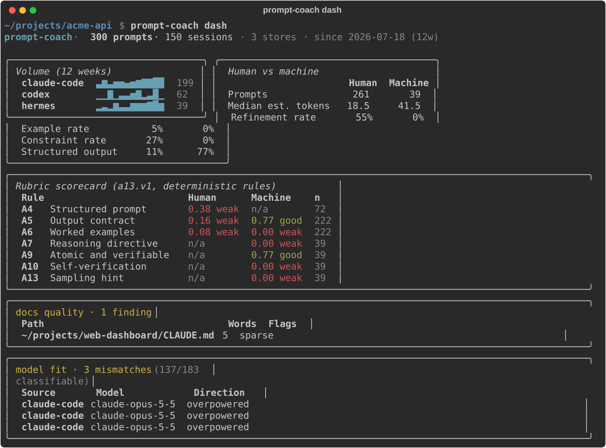
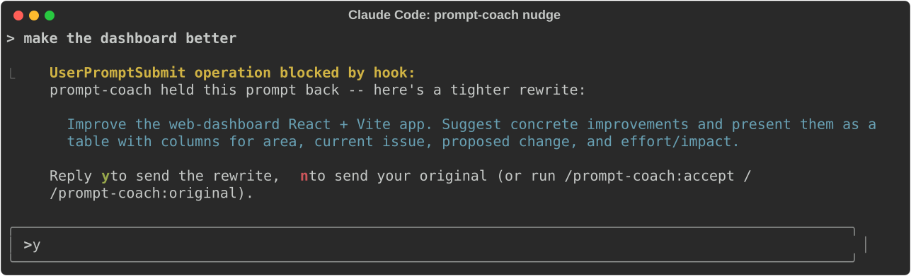

# prompt-coach

**Your personal prompting analyst. Local-first: your prompts stay on your machine unless you choose otherwise.**

> **Heads up: this project is VERY vibe-coded.** Almost all of the code,
> tests and docs were written by AI coding agents working under my
> direction, as a personal tool I use every day. It has a large test suite
> and the privacy guard is tested, but expect rough edges and odd design
> choices. Read the code before you trust it with anything important.

A CLI tool that reads your own prompt history from the AI tools you already
use, analyses your prompting style, and coaches you on it: style metrics,
scores against a 13-rule prompting rubric, LLM-detected patterns, and
(optionally) live nudges that offer a rewrite before a weak prompt is sent.

- **Works with the tools you use.** History is read straight from each
  tool's own local files. Nothing to export, nothing to install in the tool.
- **Works with any model.** Point it at any OpenAI-compatible endpoint
  (Ollama, LM Studio, llama.cpp, vLLM, or a cloud provider), or at none.
- **Works without a model.** Scoring, stats, streaks, the dashboard and the
  deterministic report need no LLM at all.

<p align="center">
  
</p>

<sub>Screenshots are real CLI output over a synthetic demo history, generated by
[`scripts/make_screenshots.py`](scripts/make_screenshots.py).</sub>

## Supported sources

All are read-only and auto-detected; `prompt-coach discover` shows what it found.

| Source | Where it reads from |
|---|---|
| Claude Code | `~/.claude/projects/*/*.jsonl` |
| Codex CLI | `~/.codex/sessions/` |
| GitHub Copilot Chat (VS Code) | VS Code `workspaceStorage/*/chatSessions/` |
| Hermes agent | `~/.hermes/state.db` |
| ChatGPT | the official data export (`prompt-coach import export.zip`) |
| Anything else | a simple JSON file (`prompt-coach import sessions.json`, format below) |

On WSL, Windows-side Copilot and Codex profiles under `/mnt/c/Users/*` are
found too. Developed and tested on Linux and WSL; the macOS and native
Windows paths are probed but not yet verified, so reports are welcome.

For a tool not listed, export its history as JSON in this shape and import it:

```json
[{"session_id": "abc", "title": "optional", "timestamp": "2026-07-01T09:00:00Z",
  "messages": [{"role": "user", "content": "..."}, {"role": "assistant", "content": "..."}]}]
```

## Quick start

Needs Python 3.12+ and [uv](https://docs.astral.sh/uv/).

```bash
git clone https://github.com/aawobdev/prompt-coach && cd prompt-coach
./install.sh          # `uv tool install`, then offers to run the setup wizard
prompt-coach setup    # choose sources, LLM endpoint (or none), nudge mode
```

Or run straight from the repo without installing:

```bash
uv sync
uv run prompt-coach discover             # list sources with counts
uv run prompt-coach report --since 30d   # coaching report over recent history
uv run prompt-coach report --no-llm      # deterministic-only, no model needed
uv run prompt-coach dash                 # terminal dashboard, no LLM needed
uv run prompt-coach score "your prompt"  # score one prompt
uv run prompt-coach query "what did I work on last week?"
```

## Choosing a model

Any server that speaks the OpenAI chat-completions API works. Run
`prompt-coach setup`, or set it in `~/.config/prompt-coach/config.toml`:

```toml
[llm]
api_base = "http://localhost:11434/v1"   # Ollama; LM Studio is :1234/v1
model = "qwen3:14b"                      # whatever your server calls it
```

With no endpoint configured, every LLM feature degrades cleanly: reports are
deterministic-only and nudges fall back to a one-line tip.

Tips:

- A local model needs enough context for the pattern-detection payload
  (~8k tokens). Ollama defaults to a 4k context; raise `num_ctx` on the model.
- Provider-specific request fields go in `extra_body` as JSON, e.g. to stop an
  OpenRouter reasoning model spending its whole budget thinking:
  `extra_body = '{"reasoning": {"enabled": false}}'`.

## Commands

| Command | Description |
|---------|-------------|
| `setup` | Interactive wizard: choose which stores are active, LLM endpoint/model, nudge mode, model-fit mode, and an optional per-directory nudge override. Writes `config.toml`, then offers to run `report` or `dash`. |
| `discover` | Find available sources (Claude Code, Codex CLI, Copilot, Hermes) |
| `score` | Score one prompt (0-100) with the bonuses and penalties behind it (`--json`) |
| `streaks` / `audit` | Good-prompt streaks, and what nudge changed and when (`--json`) |
| `report` | Coaching report: metrics, rubric scorecard, insights (`--since`, `--sample`, `--no-llm`, `--out`) |
| `dash` | Terminal dashboard: volume sparklines, segments, scorecard, project-doc quality (`--plain` for non-TTY, `--no-sync` to skip the store sync and render from cache as-is) |
| `stats` | Quick metrics table, no LLM needed |
| `query` | Natural-language question over your prompt history, with citations |
| `nudge` | Hook target for Claude Code (`UserPromptSubmit` + `Stop`) and Hermes (`pre_llm_call`). On Claude Code, default `coach` mode blocks weak prompts with an LLM-rewritten suggestion (degrades to a one-line tip if the LLM is unreachable), once per session; `always` mode blocks and rewrites every prompt (a bare `y`/`n`/`ok` answer is let through); `auto` never blocks: it asks the session model to refine the prompt itself, or with `[nudge] auto_rewrite = true` sends the LLM's rewrite straight through (falling back to self-refine); `off` disables it. After a block, reply `y` to send the rewrite or `n` to send your original. On Hermes, `pre_llm_call` can only inject context, not block, so it's always tip-only regardless of mode (`always` collapses to `coach`'s behavior there). Set via `PROMPT_COACH_NUDGE_MODE` or `[nudge] mode` in config.toml. Not meant to be run by hand. |
| `import` | Import a ChatGPT export (ZIP/JSON) or simple JSON sessions; format auto-detected |
| `nudge-consume` | Internal target for the `/prompt-coach:accept` / `/prompt-coach:original` plugin skills below -- pops the pending rewrite for a session and prints one side of it. Not meant to be run by hand. |
| `doctor` | Read-only report: is the `claude` CLI on PATH, is the plugin installed, are the legacy hooks/commands it replaces still present (`--json` for scripting). |
| `migrate-legacy` | Installs the plugin (via `claude plugin marketplace add`/`install`) and/or removes the legacy hooks/commands, whichever is needed. Shows the plan and asks to confirm; backs up everything it touches first. `--repo` overrides auto-detection, `--dry-run` previews only, `--yes` skips confirmation. |
| `cache sync/info/clear` | Manage the local analysis cache |

## Live nudges (optional)

Reports work on history alone. To be coached as you type, wire `prompt-coach
nudge` into your tool's prompt hook. Ready-made integrations exist for Claude
Code (a plugin) and Hermes (a shell hook). Any tool with a hook that passes
the prompt as JSON on stdin can call `prompt-coach nudge` the same way.

<p align="center">
  
</p>

<sub>The rewrite is real model output for that prompt. The surrounding layout
mimics Claude Code's transcript.</sub>

### Claude Code plugin

The hooks and slash commands ship as a Claude Code plugin in `plugin/`
(marketplace manifest at `.claude-plugin/marketplace.json`). It is a thin
wrapper: the hooks and skills call the installed `prompt-coach` CLI through
`plugin/scripts/pc`, a fail-open launcher that looks for the CLI on `PATH`,
then `~/.local/bin` (where `uv tool install` puts it). If the CLI is
missing it warns once and lets every prompt through.

Install (the CLI first, via `./install.sh`):

```bash
claude plugin marketplace add aawobdev/prompt-coach   # or a local path to this repo
claude plugin install prompt-coach@prompt-coach
```

What it registers:

| Piece | What it does |
|---|---|
| `SessionStart` hook (5s, new sessions only) | One line when a session starts: prompts since your last nudge and this week's most common gap, e.g. "39 prompts since your last nudge. This week's most common gap: no output format or example (13 of 15 nudges)". Shown to you, not added to Claude's context (no tokens). Silent on resume, with no history yet, or when nudge mode is `off`. |
| `UserPromptSubmit` hook (25s) | Runs `prompt-coach nudge`: scores the prompt, blocks with a rewrite (coach/always) or improves it in place (auto: the refine directive, or the LLM's rewrite with `auto_rewrite`). Also handles the `y`/`n` reply to a block. |
| `Stop` hook (10s) | Runs `prompt-coach nudge` for the hint-mode tip. |
| `/prompt-coach:accept` | Resends the rewrite `nudge` held back. |
| `/prompt-coach:original` | Resends your original prompt untouched. |
| `/prompt-coach:run <cmd>` | Runs any `prompt-coach` subcommand (`report --since 7d`, `dash --plain`, ...). |

`UserPromptSubmit` can only `block` (text reason) or add context, so there
is no real accept/reject button, and the hook can't replace your prompt
text. Instead, when `nudge` blocks a prompt with a rewrite it stashes
`{original, rewritten}` keyed by session ID
(`~/.cache/prompt-coach/nudge_pending.json`). Then:

| You send | What happens |
|---|---|
| `y` | Goes through; the rewrite rides along as context and Claude answers it |
| `n` | Same, with your original prompt |
| `/prompt-coach:accept` / `:original` | Same result via the skills; they also mark the session to skip the nudge gate once |
| anything else | Handled normally; the pending rewrite is dropped, so a later `y` can't resurrect it |

The desktop app never shows the text that was actually sent, so every path
tells Claude to open its reply by quoting it (`Sent (prompt-coach rewrite):`
or `Sent (your original prompt):`). The three skills are
user-only (`disable-model-invocation`), so Claude cannot trigger them.

Plugin skills are always namespaced `/<plugin>:<skill>`, which is why the
old short names `/coach-accept` and `/coach-original` became
`/prompt-coach:accept` and `/prompt-coach:original`.

**Migrating from the manual hook setup:** Claude Code does not de-duplicate a
plugin's hooks against the same hooks in `~/.claude/settings.json`, so
running both at once nudges every prompt twice. Run `prompt-coach
migrate-legacy` (or say yes when `prompt-coach setup` offers it): it
installs the plugin if it isn't already, removes the two legacy
`prompt-coach nudge` hook entries and the three old
`~/.claude/commands/*.md` files, and backs up everything it touches first
(`<file>.bak-<timestamp>`, same convention either way). `prompt-coach
doctor` reports the current state without changing anything, including
whether both the plugin and the legacy hooks are active at once.

### Hermes

Hermes's own hooks docs describe `pre_llm_call` as the direct equivalent of
Claude Code's `UserPromptSubmit`, and its shell hooks speak the same JSON
wire protocol. Add to `~/.hermes/config.yaml`:

```yaml
hooks:
  pre_llm_call:
    - command: "prompt-coach nudge"
      timeout: 5
```

Hermes prompts for one-time consent the first time the hook actually fires
(persisted to `~/.hermes/shell-hooks-allowlist.json`); non-interactive runs
(gateway, cron) need `--accept-hooks`, `HERMES_ACCEPT_HOOKS=1`, or
`hooks_auto_accept: true` set first, or the hook silently stays unregistered.
Unlike Claude Code, `pre_llm_call` can only inject context, never block, so
this path is always the deterministic tip (never an LLM-rewrite-and-block) --
see the `nudge` row above.

## How it works

1. **Sync**: prompts stream from each store into a local cache DB
   (`~/.cache/prompt-coach/`), incrementally; source stores are never written.
2. **Segment**: hand-typed prompts and machine-generated ones (subagent and
   orchestration task specs, cron jobs) are scored separately; the machine
   column audits your pipeline's prompt quality, the human column coaches you.
3. **Analyse**: deterministic style metrics and structural rubric checks run
   over everything; the configured LLM (if any) judges the judgement rules
   and detects patterns on a stratified sample, with every call cached.
4. **Report**: one markdown briefing. Delete `~/.cache/prompt-coach/` to erase
   every derived artifact.

## Privacy

- Source files are opened read-only and never written. Everything derived
  lives in `~/.cache/prompt-coach/`; delete it to erase all of it.
- No telemetry. The only network traffic is to the LLM endpoint you configure.
- The client refuses any endpoint that is not localhost or a private (RFC1918)
  address unless you explicitly allow it (`setup` asks; or `allow_remote = true`).

Allowing a cloud endpoint means the prompts being analysed or rewritten, plus
the project-doc excerpt and recent prompts used as context, are sent to it.
Keep the key out of config with `api_key_cmd`, and prefer a provider account
that enforces zero data retention.

## Configuration

`~/.config/prompt-coach/config.toml` (all optional; `prompt-coach setup` writes
this for you), or env vars:

- `PROMPT_COACH_API_BASE` / `[llm] api_base` - any OpenAI-compatible endpoint (default: none)
- `PROMPT_COACH_MODEL` / `[llm] model` - model name as the endpoint knows it (default: none)
- `PROMPT_COACH_ALLOW_REMOTE` / `[llm] allow_remote` - allow a non-private endpoint (default false)
- `PROMPT_COACH_API_KEY_CMD` / `[llm] api_key_cmd` - shell command that prints the
  API key, run only when an LLM client is built, so the key never sits in config.
  `PROMPT_COACH_API_KEY` / `[llm] api_key` also work; the env var wins for one-off runs.
- `PROMPT_COACH_EXTRA_BODY` / `[llm] extra_body` - JSON object merged into every
  request, for provider-specific fields (unset = send nothing). The older
  `reasoning = false` setting still loads and is saved in this form.
- `PROMPT_COACH_NUDGE_MODE` / `[nudge] mode` - `coach` (default), `auto`, `always`, `hint`, `off`
- `PROMPT_COACH_NUDGE_AUTO_REWRITE` / `[nudge] auto_rewrite` - in auto mode, send the
  LLM's rewrite straight through instead of the self-refine directive (default false)
- `PROMPT_COACH_HERMES_DB`, `PROMPT_COACH_CLAUDE_PROJECTS`, `PROMPT_COACH_COPILOT_DIR`,
  `PROMPT_COACH_CODEX_DIR`, `PROMPT_COACH_CACHE_DIR`
- `PROMPT_COACH_ENABLED_STORES` - comma-separated store list (default: all four
  live stores). Opt-in, not opt-out: a store present on disk is only used if
  named here. Equivalent to `[stores] enabled = [...]` in config.toml.
- `[nudge.dir_overrides]` in config.toml only (a mapping has no clean env-var
  form) - per-directory nudge mode, e.g. `"/home/x/scratch" = "off"`. The
  longest matching path prefix wins; falls back to the global `nudge.mode`.

## Contributing

Issues and pull requests are welcome; see [CONTRIBUTING.md](CONTRIBUTING.md).
Report security problems privately as described in [SECURITY.md](SECURITY.md).

Project docs: `AGENTS.md` (conventions and verified source-format facts, for
humans and coding agents alike), `DECISIONS.md` (why things are the way they
are), `STATUS.md` (progress log), `BLUEPRINT.md` (the original spec).

## License

[MIT](LICENSE)
